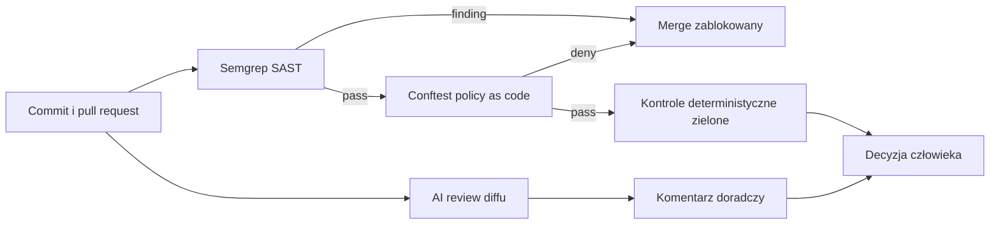

# Secure SDLC Pipeline Demo

[](https://github.com/tswierszcz/future-pipeline/actions/workflows/demo.yml)

Praktyczne demo pokazujące, jak GitHub Actions, Semgrep, Conftest i review AI
współpracują przy pull requeście — od wykrycia podatności do zablokowania merge'a
i weryfikacji poprawki.

> **English summary:** a hands-on Secure SDLC demo with deterministic Semgrep and
> Conftest gates plus advisory AI code review in GitHub Actions.

> [!WARNING]
> To repozytorium jest materiałem edukacyjnym. Zawiera celowo podatny kod,
> używany wyłącznie do demonstracji działania skanerów. Nie wdrażaj przykładów
> z katalogów `*_vuln/` w środowisku produkcyjnym.

## Historia, którą opowiada demo

Samo dodanie skanera nie tworzy Secure SDLC. Kontrole muszą być częścią
architektury procesu: uruchamiać się na każdej zmianie, dawać powtarzalny wynik,
blokować merge przy naruszeniu polityki i pozostawiać decyzję człowiekowi.

W tym repozytorium programista wprowadza command injection do zwykłego PR-a:

1. Semgrep znajduje niebezpieczne `sh -c` i ustawia wymagany check na czerwono.
2. Ochrona `main` blokuje merge.
3. Review AI opisuje scenariusz ataku i proponuje bezpieczniejsze API.
4. Programista usuwa uruchamianie powłoki.
5. Semgrep i Conftest przechodzą, a komentarz AI zostaje zaktualizowany.

### Zobacz działający przykład

- [PR #4 — celowo czerwony command injection](https://github.com/tswierszcz/future-pipeline/pull/4)
- [log Semgrep z blokującym wykryciem](https://github.com/tswierszcz/future-pipeline/actions/runs/41824508984)
- [komentarz AI do podatnej zmiany](https://github.com/tswierszcz/future-pipeline/pull/4#issuecomment-6629891017)
- [szczegółowy scenariusz prowadzenia prezentacji](GITHUBACTIONS.Md)

Nie scalaj PR #4 — jego czerwony stan jest częścią demonstracji.

## Jak płynie zmiana



| Warstwa | Rola | Blokuje merge? |
| --- | --- | --- |
| Semgrep | Wykrywa command injection i SQL injection lokalnymi regułami | Tak |
| Conftest | Sprawdza limity CPU i pamięci w manifeście Kubernetes | Tak |
| AI review | Analizuje diff i aktualizuje jeden komentarz w PR-ze | Nie |
| Branch protection | Wymaga zielonego `security-pipeline` | Tak |
| Człowiek | Ocenia kontekst, false positives i sens poprawki | Podejmuje decyzję |

## Najszybszy start — własny czerwony PR

1. Zrób fork repozytorium i sklonuj **swój fork**.
2. Utwórz gałąź demonstracyjną i podmień bezpieczny plik na podatny:

```bash
git switch main
git pull --ff-only
git switch -c demo/command-injection
cp app_command_vuln/CommandController.java app/CommandController.java
git add app/CommandController.java
git commit -m "demo: introduce command injection"
git push -u origin demo/command-injection
```

3. Otwórz PR z `demo/command-injection` do `main` **w swoim forku**.
4. Otwórz czerwony check `security-pipeline` i znajdź regułę
   `java-command-injection-demo`.

Semgrep i Conftest nie wymagają sekretów. Review AI bez `OPENAI_API_KEY`
zostanie jawnie pominięte w logu.

### Włącz review AI w swoim forku

Dodaj sekret repozytorium bez umieszczania klucza w historii poleceń:

```bash
gh secret set OPENAI_API_KEY --repo TWOJ_LOGIN/future-pipeline
gh secret list --repo TWOJ_LOGIN/future-pipeline
```

Opcjonalnie ustaw model:

```bash
gh variable set OPENAI_REVIEW_MODEL \
  --body "gpt-4.1-mini" \
  --repo TWOJ_LOGIN/future-pipeline
```

Workflow AI działa dla gotowych PR-ów z gałęzi tego samego repozytorium.
PR-y z zewnętrznych forków, drafty i Dependabot są pomijane, aby nie udostępniać
sekretów niezaufanemu kodowi.

### Napraw podatność

Na tej samej gałęzi przywróć bezpieczną implementację:

```bash
cp app_command_fixed/CommandController.java app/CommandController.java
```

Dodaj wewnątrz metody krótki komentarz, aby PR zachował niepusty diff względem
`main`, na przykład:

```java
// Avoid a command shell for user-controlled input.
```

Następnie wyślij poprawkę:

```bash
git add app/CommandController.java
git commit -m "demo: remove command injection"
git push
```

Semgrep i Conftest powinny przejść. AI aktualizuje istniejący komentarz zamiast
tworzyć nowy, dlatego pokaż lub zapisz podatną analizę przed wysłaniem poprawki.

## Uruchomienie lokalne

Wymagania:

- Bash i Python 3.10+;
- [Semgrep](https://semgrep.dev/docs/getting-started/);
- [Conftest](https://www.conftest.dev/install/);
- opcjonalnie pakiet `openai` i klucz API dla automatycznej poprawki SQL.

Przykładowe środowisko Pythona:

```bash
python3 -m venv .venv
source .venv/bin/activate
python3 -m pip install --upgrade pip
python3 -m pip install semgrep==1.183.0
```

Po zainstalowaniu Conftest uruchom:

```bash
# Oczekiwany PASS: bezpieczny kod + poprawna polityka Kubernetes
./pipeline.sh

# Oczekiwany FAIL: command injection wykryte lokalną regułą
./pipeline_fail.sh
```

Skrypty wykonują SAST i policy check. Pliki Java są małymi przykładami,
a nie kompletnym projektem Maven/Gradle.

### Opcjonalny AI fix dla SQL injection

`pipeline_ai_fix.sh` modyfikuje wskazany `UserController.java`. Użyj katalogu
tymczasowego, aby nie zmieniać szablonu w repozytorium:

```bash
DEMO_DIR="$(mktemp -d)"
cp -R app_vuln "$DEMO_DIR/app"

# Bez klucza zostanie użyta deterministyczna poprawka demonstracyjna.
./pipeline_ai_fix.sh "$DEMO_DIR/app"

# Z prawdziwym API — wpisany klucz nie pojawi się w historii poleceń:
python3 -m pip install openai
read -rsp "OPENAI_API_KEY: " OPENAI_API_KEY
export OPENAI_API_KEY
echo
./pipeline_ai_fix.sh "$DEMO_DIR/app"
unset OPENAI_API_KEY
```

Nie zapisuj klucza w pliku, commicie ani historii terminala współdzielonego
z innymi osobami.

## Gotowe scenariusze

| Scenariusz | Podatny szablon | Bezpieczny szablon | Reguła |
| --- | --- | --- | --- |
| Command injection | `app_command_vuln/CommandController.java` | `app_command_fixed/CommandController.java` | `rules/java-command-injection-demo.yml` |
| SQL injection | `app_vuln/UserController.java` | `app_fixed/UserController.java` | `rules/java-sqli-demo.yml` |
| Kubernetes policy | usuń limit z `infra/deployment.yaml` | `infra/deployment.yaml` | `policies/deployment.rego` |

Katalog `app/` jest bezpiecznym punktem startowym skanowanym przez workflow.
Katalogi `*_vuln/` są tylko szablonami i nie są wdrażane.

## GitHub Actions

### Deterministyczna bramka bezpieczeństwa

`.github/workflows/demo.yml` uruchamia się dla PR-ów i pushy do `main`:

1. instaluje przypiętą wersję Semgrep;
2. skanuje `app/` wszystkimi lokalnymi regułami z `rules/`;
3. przy braku findingów instaluje Conftest;
4. sprawdza `infra/deployment.yaml` regułami Rego.

Job `security-pipeline` jest wymaganym statusem w ochronie gałęzi `main`.

### Doradcze review AI

`.github/workflows/ai-review.yml` uruchamia `ai_review.py` z commita bazowego PR-a,
nie z kodu dostarczonego przez autora zmiany. Skrypt:

- pobiera diff przez GitHub REST API;
- ogranicza wejście do 40 000 znaków i odpowiedź do 2500 tokenów;
- wysyła najwyżej jedno żądanie do OpenAI Responses API;
- używa `store: false`;
- przed publikacją sprawdza, czy PR nadal wskazuje analizowany SHA;
- tworzy lub aktualizuje jeden komentarz bota.

Review AI jest celowo nieblokujące. Model może przeoczyć błąd, zmienić język
odpowiedzi lub zgłosić uwagę wymagającą szerszego kontekstu.

## Struktura repozytorium

```text
.github/workflows/       GitHub Actions: security gate i AI review
app/                     bezpieczny kod skanowany w CI
app_command_vuln/        szablon command injection
app_command_fixed/       poprawka bez wywoływania powłoki
app_vuln/                szablon SQL injection
app_fixed/               poprawka z PreparedStatement
rules/                   lokalne reguły Semgrep
infra/                   manifest Kubernetes
policies/                polityki Conftest/Rego
tests/                   testy ai_review.py bez sieci i kluczy
decks/                   slajdy z konferencji
```

## Slajdy i instrukcja prowadzącego

- [slajdy po polsku](decks/Pipeline_2.0_PL.pdf)
- [slides in English](decks/Pipeline_2.0_EN.pdf)
- [pełny scenariusz prezentacji](GITHUBACTIONS.Md)

## Testy

Testy review AI nie wykonują połączeń sieciowych i nie potrzebują klucza:

```bash
python3 -m unittest discover -s tests -v
```

Pokrywają między innymi limity diffu, brak sekretu, błędną odpowiedź API,
aktualność SHA oraz tworzenie i aktualizowanie komentarza.

## Bezpieczeństwo i ograniczenia

- Kod z diffu trafia do API OpenAI tylko wtedy, gdy skonfigurujesz klucz.
- `store: false` wyłącza zapis odpowiedzi jako zasobu Responses; nie jest
  obietnicą zerowej retencji wszystkich danych API.
- Prompt ogranicza prompt injection, ale nie gwarantuje poprawności modelu.
- Celowo podatny kod może uruchamiać skanery — to
  oczekiwany wynik tego repozytorium.
- Repozytorium nie uruchamia podatnych przykładów w GitHub Actions.

## Materiały konferencyjne i dalsze użycie

Forkuj repo, odtwórz czerwony PR, dodaj własną regułę Semgrep albo politykę Rego
i porównaj deterministyczny wynik narzędzia z komentarzem modelu. Najważniejszy
wniosek pozostaje ten sam: AI pomaga wyjaśniać, ale reguły i człowiek odpowiadają
za decyzję o merge'u.

## Licencja

Kod i materiały w tym repozytorium są dostępne na licencji
[MIT](LICENSE).
